**[Download Antler 1.1.0](https://github.com/sanders60r/Antler/releases/download/v1.1.0/Antler-1.1.0.exe)**
is the direct link, but please take the time to read this whole page first.

[Help support the development of the Antler project by contributing to ensure its continuous improvement.](https://www.paypal.com/donate/?business=HPAFAKEF7BT34&no_recurring=0&item_name=Help+support+the+development+of+the+Antler+project+by+contributing+to+ensure+its+continuous+improvement.&currency_code=USD)

# Antler

**Antler reads, flashes and logs the engine computer in your Volvo (Bosch ME7 and
ME9), and it is built to be easy.** Plug in the cable, press one button, and
Antler works out your car, its software and the right logging file by itself.

It is made for owners working on their own car. You do not need to know which
platform you have, which file to load or which settings to pick.

> **Antler writes to your engine computer. A failed or wrong write can leave the
> car unable to start until it is recovered.** Use a battery charger while
> reading or flashing, keep a backup read of your ECU, and use it at your own
> risk. There is no warranty of any kind.

## The short version

1. Plug in the cable and switch the ignition on.
2. Press **Detect car**.
3. **If the button turns green and says "Car Detected!", you are good to go.**
   Read, flash or log.

**If it does not turn green, press Send report and I will fix it.** That is the
whole idea: you should never have to work out what went wrong yourself.

**If your car answers but Antler does not know its software yet**, Antler asks
whether you want to add it. Press **Read my car** and Antler reads the engine
computer in one go (memory and flash on ME7, flash on ME9), then opens Send
report with everything filled in. Press Send, and your car gets added in an
upcoming update.

## A walk through Antler

### The welcome screen

Every time you open Antler it greets you with this screen, and after an update
it tells you so. It covers what Antler does, the three steps above, what has
been proven on real cars and what is coming next.

The amber **What's New?** button takes you straight to the patch notes. Press
**Get started** when you are ready.

### What's New?

The patch notes list what changed in each version, in plain words, newest first.
You can open them any time from **Patch notes** in the bottom-left corner.

### The main screen

Everything is on one screen, with the tabs down the left: **Read / Flash**,
**Logging** and **Diagnostics** for working with the car, then **Boost
control**, **Fueling** and **Ignition** for the tuning tools.

**Detect car is the only button you need to press first.** It finds your car,
reads the VIN and the software in the engine computer, and fills in the top bar
for you: software, flash size, logging file, car and VIN. The VIN stays hidden
until you press **Show VIN**. When the button turns green, the car is recognised
and everything else is set up.

- **Read** saves a full copy of your engine computer to a `.bin` file. Do this
  first; it is your backup. Nothing is written to the car.
- **Flash** writes a `.bin` to the engine computer. Antler checks the file
  before anything is written and tells you in plain words if something does not
  look right. It also shows your battery voltage and warns you when it is low.
  Before a flash read or a write, Antler checks that the engine is not running
  and asks you to switch it off and turn the key back to position II.
- **When a read finishes, an amber Send this read button appears.** One press
  sends that `.bin` straight to me. No hunting for files, no attaching anything
  to an email.
- **Send report** sits in the bottom-left corner. If there is an error, or your
  car is not detected, press it and I will get it sorted. A report always
  carries your newest flash read and RAM dump, so there is nothing to attach by
  hand.

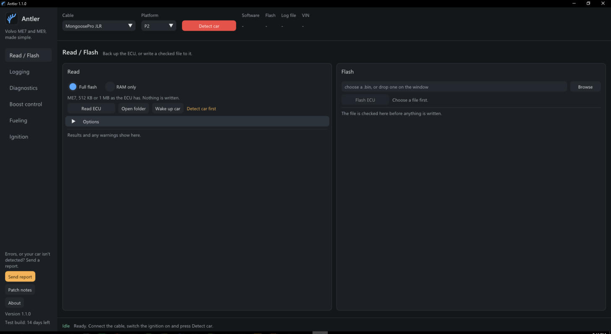

### Logging

Antler has the logging files for the common ME7 and ME9 software built in. This
is the list of them:

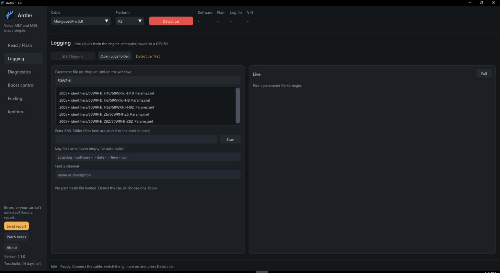

**If your car was detected, you will never see that list.** Detect car has
already picked the right file, and the screen opens ready to log. Here it is
with the **Boost control** log profile picked:

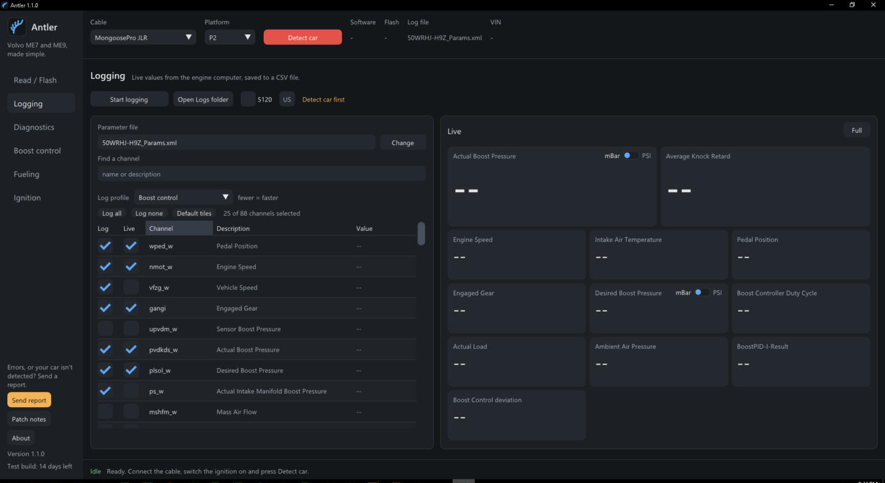

- **Start logging** is green when the car is detected and ready. Press it, and
  it turns red; press it again to stop.
- **Log profile** picks the channels for one job. Full logs everything in the
  logging file. **Boost control**, **Fueling** and **Ignition** log only what
  that job needs (about a quarter to a third of the channels), so each channel
  is read more often and the log is cleaner. Fueling includes desired and actual
  fuel pressure and fuel pump duty where your car's logging file has them. You
  can still tick or untick single channels after picking a profile.
- **MPH or km/h** sets the unit for vehicle speed, in the log file and on the
  live tiles. Antler remembers your choice.
- Live values show as big, easy-to-read tiles. Boost switches between mBar and
  PSI with the small slider on its tile.
- **When you stop a log, an amber Send this log button appears.** One press
  sends that log straight to me.
- **5120**, **Speed density** and **Flex fuel** are for cars with those specific
  custom setups. **Leave them alone unless you know your car needs them.**

Reads, logs and everything else Antler saves are kept in tidy folders next to
the program, so nothing ends up scattered around your computer.

**Your log, opened in MegaLogViewer.** This is a real Antler log from a 2013
C30 T5 (ME9), taken with a DiCE cable: 56 channels at about six samples a
second. Boost, wastegate duty, pedal, RPM, airflow, load, knock, lambda and
fuel pressure are all there, named and scaled, straight from the built-in
logging file.

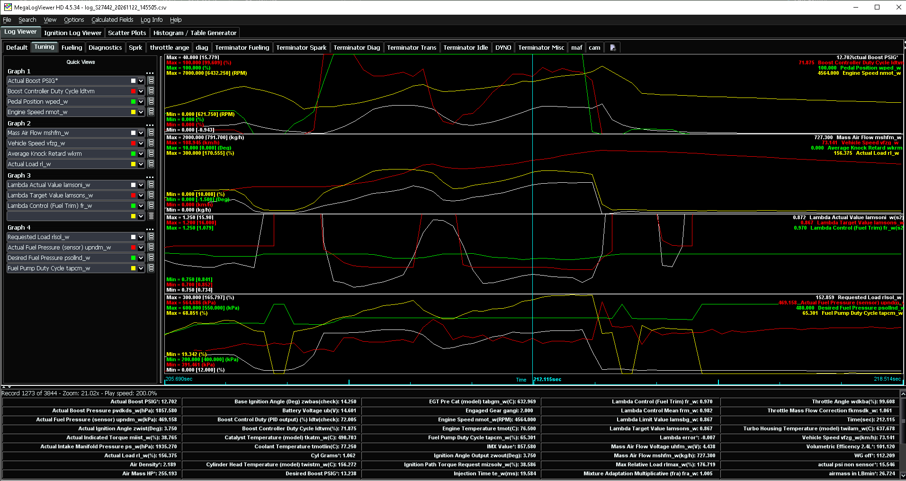

### Diagnostics

Read your engine computer's fault codes with one press. **These are the real
fault descriptions for your Volvo, taken from Volvo's own dealer database, not
generic OBD codes.** You can clear them from the same screen.

Since 0.9.25 the other modules can be read and cleared too: pick the gearbox,
brakes, airbag (SRS), central module, dash, climate, doors and so on from the
**Module** list, or press **Scan all modules** to ask them all at once and
**Clear all these** to clear every module that had codes. Codes from modules
other than the engine are shown by number, the way VIDA writes them
(`SRS-00D5`). Clearing an airbag code does not fix anything: if the light comes
back, have the system checked.

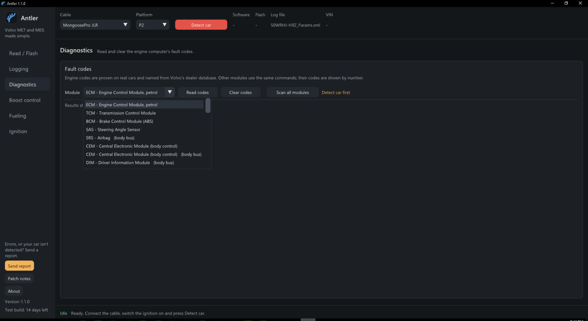

### Boost control, Fueling and Ignition

**These tabs are for advanced users.** They are for people who edit their own
maps and know what those maps do. If you only read, flash and log, you can leave
them alone. (Up to 0.9.23 they were one tab called Calibrations.)

Each tab holds the tuning tools for one job. They used to be separate programs
of mine:

- **Boost control**: **LDRPID boost**, the wastegate pre-control maps, built from
  fixed-duty pulls.
- **Fueling**: **FKKVS**, the fuel correction map worked out from lambda and fuel
  trims, and **KRKTE / TVUB**, the injector constant and dead time (the first
  step after an injector change).
- **Ignition**: **KFZW knock**, the base ignition maps, pulled back where your
  logs show knock.

Each tab has two sides:

- **From logs** is the tools themselves. They never talk to the car: each takes a
  `.bin` and your logs, works out a correction, and saves a new `.bin`.
  **Log for this** takes you to Logging with the right log profile already
  picked.
- **Live** is where live tuning is coming: changing the car while it runs, with
  no flash in between. What is already there is that job's own **Start logging**,
  with only its channels, the 5120 and MPH / km/h settings, and the live values.
  When you stop, **Use this log** hands the log straight to the tool.

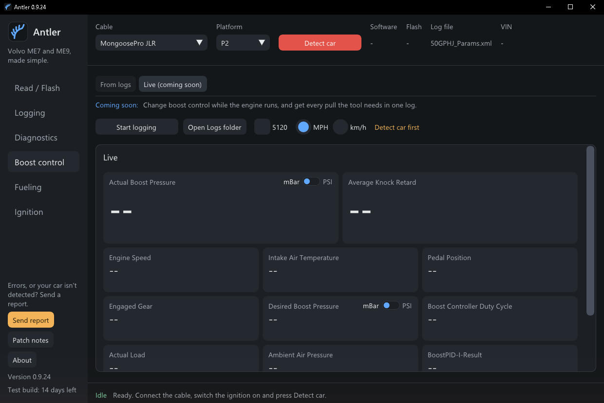

Fueling has a button for each of its two tools:

The tools all work the same way:

- **Drag and drop.** Drop the bin and the CSV logs anywhere on the window and
  the tool on screen takes them both. Antler recognises the software in the bin
  (ME7 and ME9) and finds the maps by itself.
- **Your original file is never changed.** A tool saves a new file into
  `Calibrations\Output` next to Antler, and never over an earlier one.
- **Flash this file** hands the saved bin to Read / Flash. Antler corrects the
  checksums when it writes.
- **Nothing is uploaded.** Everything is worked out on your own PC.

> The screenshots below are here to show what the tools can do. They are real
> files from real cars, but they were not picked as examples of good tuning data.
> They were taken before the tools moved to their own tabs, so the row of
> buttons above each tool looks a little different now.

#### KFZW knock

The knock tool reads the base ignition maps straight from the bin. This is a
C30 T5 (ME9) file just after it was dropped in:

Drop in a log made on that file and the map updates at once. These are the
default settings: half of the knock the log shows is taken out of each cell,
with light smoothing into the cells around it. The red cells are the ones that
changed.

The **Knock** view shows how much knock the log itself holds, cell by cell (set
here to show the worst sample in each cell). Two to three degrees at the most is
not much in reality, so this is not a log that calls for drastic changes.

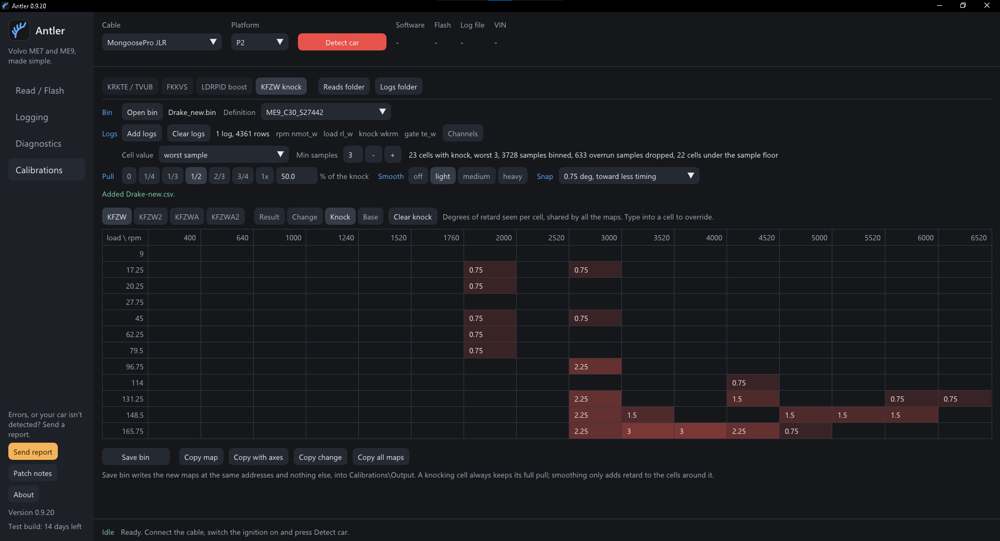

This is the same bin and log with the settings turned up: all of the knock taken
out, and heavy smoothing.

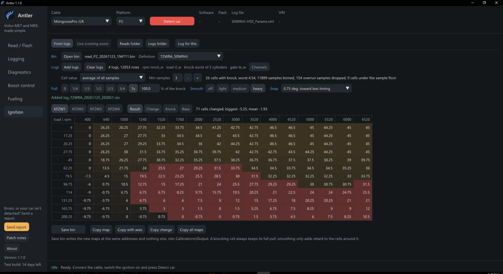

Smoothing matters more than it looks. I have seen more knock in logs caused by a
jumpy timing table than by real pre-detonation, so you want a good, smooth
timing map, especially in the high-load rows.

#### LDRPID boost

A modern update of a tried and true method that has been in use for years. The
original write-up is on the Nefmoto forums:
[Actual pre-control in LDRPID](https://nefariousmotorsports.com/forum/index.php?msg=102466).

**This tool is only for cars that need it:** an upgraded turbo, a custom
wastegate actuator and the like.

It does two jobs. **Generate** builds the maps from fixed-duty pulls, and
**Check and correct** measures a calibration against ordinary full-throttle
logs.

Here it is with a bin and the calibration logs from an older setup of mine:
eleven logs, each a pull at one fixed wastegate duty. Antler reads the axes and
the boost-control settings from the bin, and works out by itself that this file
is a 5120 calibration. The amber lines are the tool telling you what is weak
about the logs it was given; here, a slow logging rate and no ambient pressure
channel.

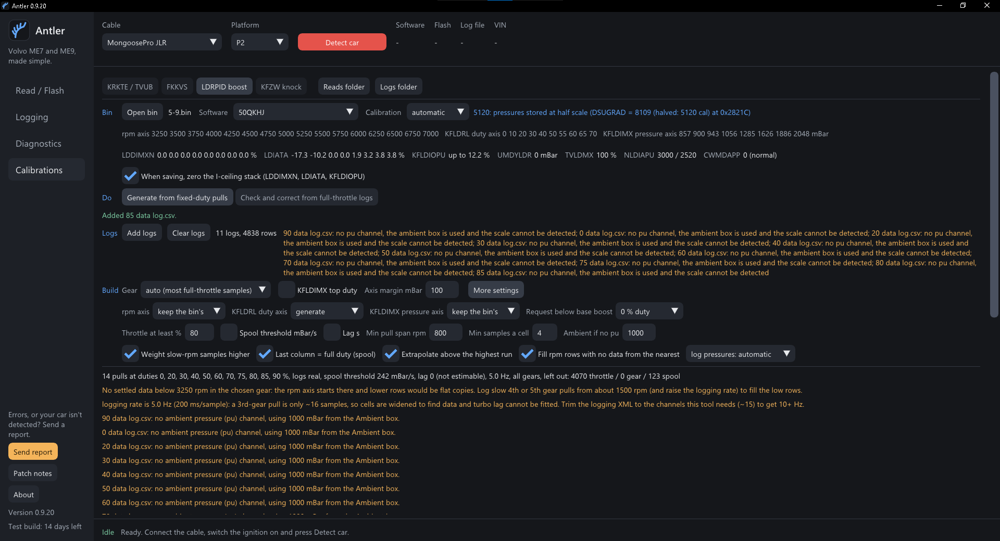

**Settled boost** is what the car actually did: the boost pressure (mBar, the
same as hPa) it made at each fixed wastegate duty, at each engine speed. The
duties here are 0, 20, 30, 40, 50, 60, 70, 75, 80, 85 and 90 %.

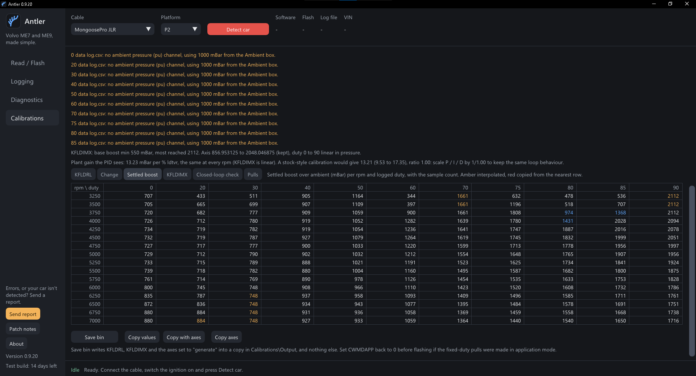

From that, the tool calibrates the wastegate maps, so that when the tune asks
for a given boost pressure the engine computer knows which duty reaches it. This
is the **KFLDRL** it produced:

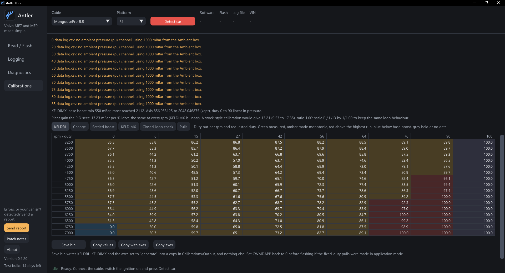

I did not adjust any settings for this, and the logs are from a setup I ran a
long time ago. For a final map I would take my time and work through the
settings. This is only to show what can be done.

#### FKKVS

My bread and butter. FKKVS corrects the fuel trims for aftermarket or upgraded
injectors. This car runs Injector Dynamics 1050x injectors. The file started
with its FKKVS map at 1.000 everywhere, and this is the first pass: red cells
get more fuel, blue cells less. Click a cell to lock it at its original value.

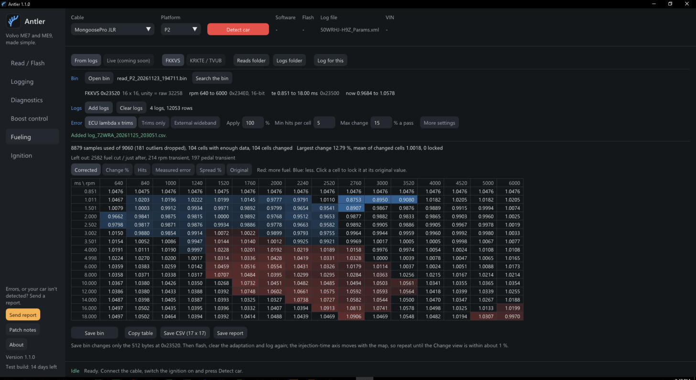

**KRKTE / TVUB** is the step before this one. It separates the injector constant
from the dead time, so that FKKVS only has to carry what those two leave behind.

**Long-term fuel trims have to be switched off while you log for the fuel
tools.** Otherwise the engine computer keeps learning and the logs are not
useful. That is done with NOLRA:

| Engine computer | Trims on | Trims off |
|---|---|---|
| ME7, 2004 and older | `04` | `07` |
| ME7, 2005 and newer | `84` | `87` |
| ME9 | `24` | `27` |

These are raw hex values. I always switch to hex when I edit NOLRA:

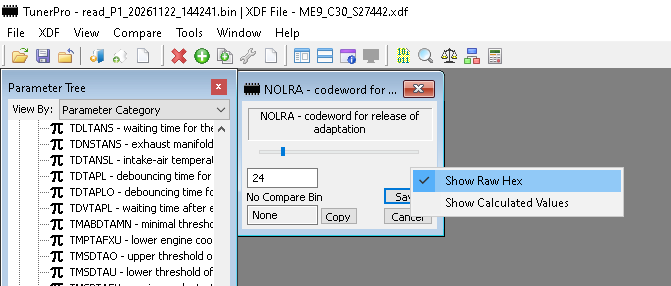

### Updates

Antler checks for a newer version each time it starts. When there is one, the
bottom-left corner tells you, as in this older copy of Antler. Press **Get the
update** to open the download page. Please stay up to date: each version fixes
things and supports more cars.

## What has been tested

| Feature | Status |
|---|---|
| ME7 on P2 (S60/V70/S80/XC90, 2001-2005+): detect, read, flash, log | Tested on several cars |
| ME9 on P1 (C30/S40/V50/C70): detect, read, log | Tested on four cars. Two reads of one car, two days apart, were identical |
| Diagnostics: reading fault codes | Tested on two ME9 cars |
| Diagnostics: other modules, scan and clear (new in 0.9.25) | Not yet confirmed on a car |
| Tuning tools (Boost control, Fueling, Ignition) | They work from files, not from the car. Each gives the same output as the stand-alone tool it replaces, checked on several hundred bin and log sets |
| ME9 on P1: flashing | Worked on one car (2011 C30 T5, DiCE cable), confirmed by reading the ECU back: identical to the file flashed |
| Battery voltage reading and **Send this read** (new in 0.9.10) | Not yet confirmed on a car |
| Engine-running check before a flash read or a write (new in 0.9.14) | Not yet confirmed on a car |
| P80 ME7 (10-series software): detect, read, flash, log | Tested on one car (1999 C70, 10J0MG, 512 KB) |
| "Your car is not in Antler yet": the one-go read and report (new in 0.9.24) | Not yet confirmed on a car |
| Log profiles and MPH / km/h (new in 0.9.24) | Not yet confirmed on a car |
| Recovery after an interrupted write, "Wake up car" | Not yet tested on a car |

Cables used so far: Drew Technologies Mongoose (JLR) and Volvo DiCE (the ME9
flash above was done with a DiCE). Any J2534 cable with a 32-bit driver should
work.

## Getting started

1. Download the latest `Antler-x.y.z.exe` from the
   [Releases](../../releases) page.
2. **Put it in a folder of its own** (for example `Documents\Antler`) before
   running it. Antler saves your reads, logs and settings next to itself, so
   they would otherwise end up loose in your Downloads folder.
3. Install the driver for your J2534 cable if you have not already.
4. Connect the cable to the car, switch the ignition on, start `Antler-x.y.z.exe`.
5. Press **Detect car** before anything else.

Needs Windows 10 or 11. Nothing else has to be installed.

**Current releases are test builds.** Each one stops opening 14 days after it
was built, so that feedback always comes from a recent version. Antler tells you
when a newer version is out; get it from the Releases page. Your reads, logs and
settings are not touched when a build runs out.

Antler keeps everything next to its exe: `Reads\`, `Logs\`, `Flashed\`
(backups and copies of what was written), `Calibrations\Output\` (bins saved
by the tuning tools), `Reports\`, `antler.log` and `Antler.settings`.

### Windows or antivirus warnings

Antler is new and its releases are not code-signed yet, so Windows SmartScreen
or an antivirus program may warn about it. Only download it from this
repository's Releases page.

## Privacy

Antler sends nothing about you or your car by itself.

- **When it starts**, Antler asks GitHub for the newest Antler version number, so
  it can tell you when an update is out. Nothing is downloaded or installed. A
  test build also asks a public web server (Microsoft, Google or Cloudflare)
  what the date is, to know when its 14 days are up.
- **Send report** uploads only when you press it. It sends the details you type
  in the form, the car's VIN, this session's ECU reads and logs, your newest
  flash read and RAM dump (even from an earlier session), `antler.log` and
  `Antler.settings`. After a "Read my car" read the form opens by itself, but
  nothing is sent until you press Send. To work out why a cable is not found, a report also
  lists the cable drivers on the PC and any USB devices that look like a cable
  or have no driver (type and description only, no serial numbers).
- **Send this log** and **Send this read** also upload only when you press them.
  Each sends one file (the log as a CSV, or the read as a `.bin`, exactly as it
  was saved), the car's VIN and software, and the name and gearbox from the last
  report form if you filled one in.
- **The tuning tools** send nothing. They work on your PC from the files
  you give them.

If something could not be sent because there was no internet, Antler sends it
the next time it is opened. Everything that is sent goes to the project
maintainers and is used to fix problems and add support for more software
versions.

## Credits

- **Antler** by [sanders60r](https://github.com/sanders60r) (also
  [s60rawr](https://github.com/s60rawr)).
- **prometey1982** - [VolvoTools](https://github.com/prometey1982/VolvoTools), the
  flashing and logging engine Antler is built on, used with permission.
- The people credited in the [VolvoTools README](https://github.com/prometey1982/VolvoTools#readme): dream3R, rkam,
  jazdw and maZer.GTi.
- [rlinewiz](https://github.com/rlinewiz), developer of OpenMoose, and the wider
  Volvo tuning community, for logging definitions, testing and ECU reads.
- [TysiacSzescset](https://github.com/TysiacSzescset) and
  [VolvoMagicTunerStudio](https://github.com/TysiacSzescset/VolvoMagicTunerStudio-releases),
  the inspiration that set Antler off down this path.

## License

Antler is free to download and use. Its source code is not published.

The flashing and logging engine inside Antler is
[VolvoTools](https://github.com/prometey1982/VolvoTools) by prometey1982, used
with his permission. That code remains his; contact him before reusing it.
