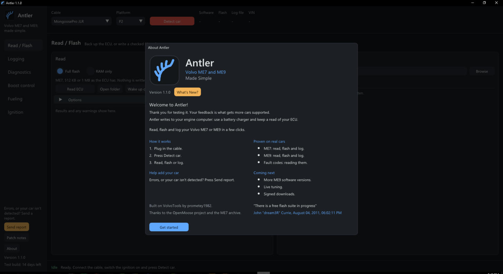
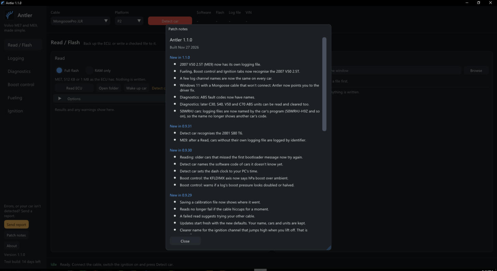
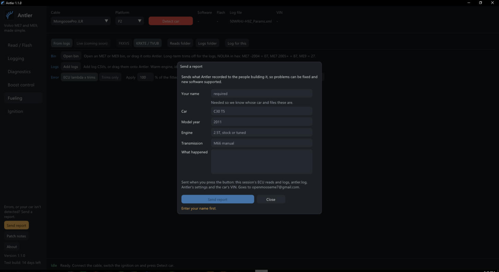
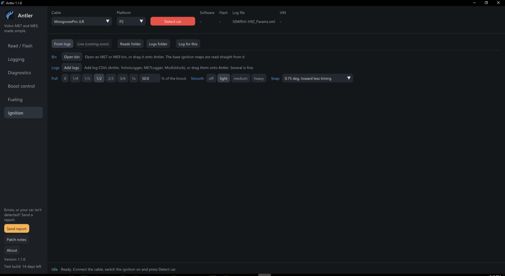
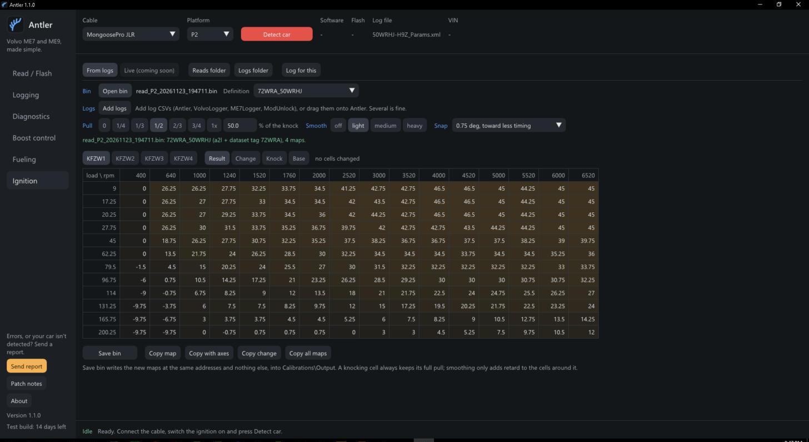
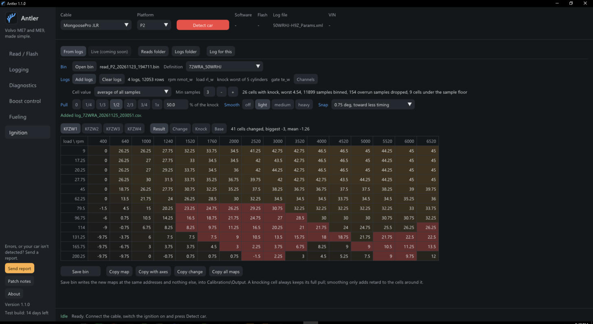
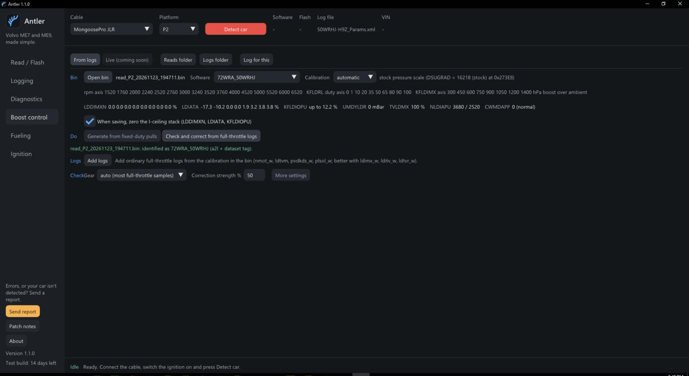
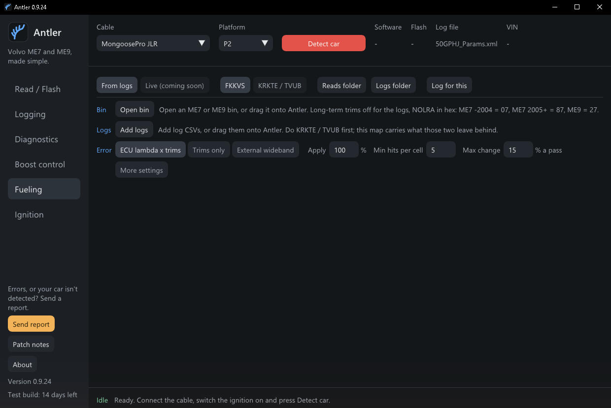
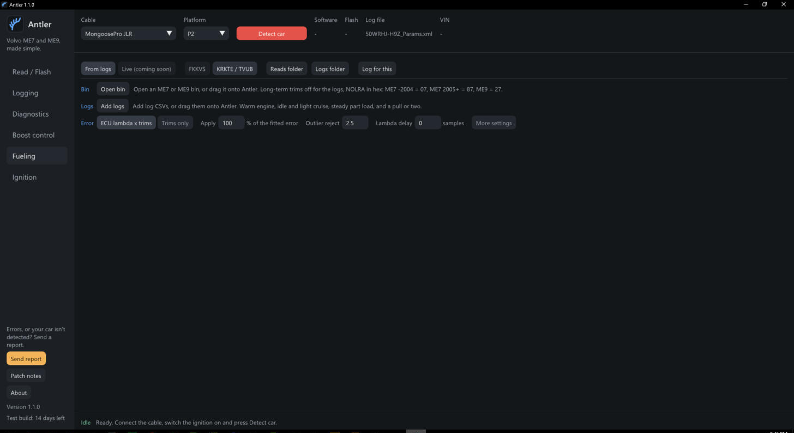
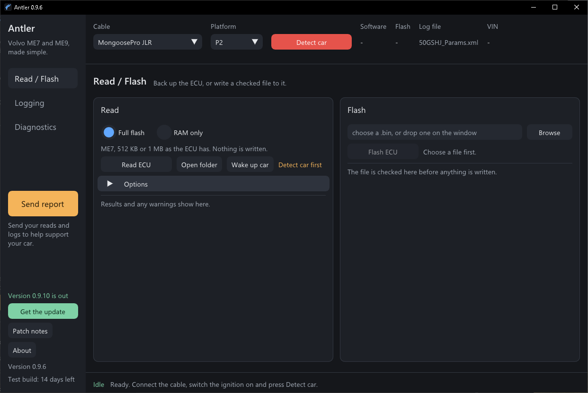

**[Download Antler 1.2.0](https://github.com/sanders60r/Antler/releases/download/v1.2.0/Antler-1.2.0.exe)**
is the direct link, but please take the time to read this whole page first.

[Help support the development of the Antler project by contributing to ensure its continuous improvement.](https://www.paypal.com/donate/?business=HPAFAKEF7BT34&no_recurring=0&item_name=Help+support+the+development+of+the+Antler+project+by+contributing+to+ensure+its+continuous+improvement.&currency_code=USD)

# Antler

**Antler reads, flashes and logs the engine computer in your Volvo (Bosch ME7 and
ME9), and it is built to be easy.** Plug in the cable, press one button, and
Antler works out your car, its software and the right logging file by itself.

It is made for owners working on their own car. You do not need to know which
platform you have, which file to load or which settings to pick.

> **Antler writes to your engine computer. A failed or wrong write can leave the
> car unable to start until it is recovered.** Use a battery charger while
> reading or flashing, keep a backup read of your ECU, and use it at your own
> risk. There is no warranty of any kind.

## The short version

1. Plug in the cable and switch the ignition on.
2. Press **Detect car**.
3. **If the button turns green and says "Car Detected!", you are good to go.**
   Read, flash or log.

**If it does not turn green, press Send report and I will fix it.** That is the
whole idea: you should never have to work out what went wrong yourself.

**If your car answers but Antler does not know its software yet**, Antler asks
whether you want to add it. Press **Read my car** and Antler reads the engine
computer in one go (memory and flash on ME7, flash on ME9), then opens Send
report with everything filled in. Press Send, and your car gets added in an
upcoming update.

## What's new in 1.2.0

- The 1999 S80 2.0T automatic (20S1 software) is now recognised, with its own
  logging file. The Ignition tab recognises it too.

From 1.1.0, released the same day:

- The 2007 V50 2.5T (ME9) has its own logging file, and the Fueling, Boost
  control and Ignition tabs recognise it.
- Log channel names are the same on every car.
- **Windows 11 with a Mongoose cable that will not connect:** Antler now points
  you to the driver fix (see [Cables](#cables)).
- Diagnostics: ABS fault codes now have names, and the later C30, S40, V50 and
  C70 ABS units can be read and cleared too.
- 50WRHJ cars: logging files are now named by the car's program
  (`50WRHJ-H9Z` and so on), so the name no longer shows another car's code.

The full list for every version is under **Patch notes** in Antler.

## A walk through Antler

### The welcome screen

Every time you open Antler it greets you with this screen, and after an update
it tells you so. It covers what Antler does, the three steps above, what has
been proven on real cars and what is coming next.

The amber **What's New?** button takes you straight to the patch notes. Press
**Get started** when you are ready.

### What's New?

The patch notes list what changed in each version, in plain words, newest first.
You can open them any time from **Patch notes** in the bottom-left corner.

### The main screen

Everything is on one screen, with the tabs down the left: **Read / Flash**,
**Logging** and **Diagnostics** for working with the car, then **Boost
control**, **Fueling** and **Ignition** for the tuning tools.

**Detect car is the only button you need to press first.** It finds your car,
reads the VIN and the software in the engine computer, and fills in the top bar
for you: software, flash size, logging file, car and VIN. The VIN stays hidden
until you press **Show VIN**. When the button turns green, the car is recognised
and everything else is set up. Until then it is red, and the buttons that need
the car say **Detect car first**.

- **Read** saves a full copy of your engine computer to a `.bin` file. Do this
  first; it is your backup. Nothing is written to the car.
- **Flash** writes a `.bin` to the engine computer. Antler checks the file
  before anything is written and tells you in plain words if something does not
  look right. It also shows your battery voltage and warns you when it is low.
  Before a flash read or a write, Antler checks that the engine is not running
  and asks you to switch it off and turn the key back to position II.
- **When a read finishes, an amber Send this read button appears.** One press
  sends that `.bin` straight to me. No hunting for files, no attaching anything
  to an email.

### Send report

**Send report** sits in the bottom-left corner. If there is an error, or your
car is not detected, press it, fill in your name and car, and I will get it
sorted. A report always carries your newest flash read and RAM dump, so there
is nothing to attach by hand.

### Logging

Antler has the logging files for the common ME7 and ME9 software built in, and
the filter box finds one by name. Here the list is narrowed to the 50WRHJ
files, which are now named by the car's program:

**If your car was detected, you will never see that list.** Detect car has
already picked the right file, and the screen opens ready to log. Here it is
with a logging file loaded and the **Boost control** log profile picked:

- **Start logging** is ready to go once the car is detected. Press it to start,
  and again to stop.
- **Log profile** picks the channels for one job: **Boost, fueling & ignition**,
  **Boost control**, **Fueling**, **Ignition**, or **Full (everything)**. Fewer
  channels means each one is read more often, so the log is cleaner. You can
  still tick or untick single channels, in the **Log** column for the file and
  the **Live** column for the tiles.
- Live values show as big, easy-to-read tiles. Boost switches between mBar and
  PSI with the small slider on its tile.
- The units button next to **5120** sets vehicle speed to MPH or km/h, in the
  log file and on the tiles. Antler remembers your choice.
- **When you stop a log, an amber Send this log button appears.** One press
  sends that log straight to me.
- **5120**, **Speed density** and **Flex fuel** are for cars with those specific
  custom setups. **Leave them alone unless you know your car needs them.**

Reads, logs and everything else Antler saves are kept in tidy folders next to
the program, so nothing ends up scattered around your computer.

**Your log, opened in MegaLogViewer.** This is a real Antler log from a 2013
C30 T5 (ME9), taken with a DiCE cable: 56 channels at about six samples a
second. Boost, wastegate duty, pedal, RPM, airflow, load, knock, lambda and
fuel pressure are all there, named and scaled, straight from the built-in
logging file.

### Diagnostics

Read your engine computer's fault codes with one press. **Engine codes are the
real fault descriptions for your Volvo, taken from Volvo's own dealer database,
not generic OBD codes.** You can clear them from the same screen.

The other modules can be read and cleared too: pick the gearbox, brakes (ABS),
steering angle sensor, airbag (SRS), central module, dash and so on from the
**Module** list, or press **Scan all modules** to ask them all at once. **ABS
codes now have names as well.** Codes from the other modules are shown by
number, the way VIDA writes them (`SRS-00D5`). On the later C30, S40, V50 and
C70, the ABS unit is in the list as its own entry and is included in Scan all.

Clearing an airbag or ABS code does not fix anything: if the light comes back,
have the system checked.

### Boost control, Fueling and Ignition

**These tabs are for advanced users.** They are for people who edit their own
maps and know what those maps do. If you only read, flash and log, you can leave
them alone.

Each tab holds the tuning tools for one job. They used to be separate programs
of mine:

- **Boost control**: **LDRPID boost**, the wastegate pre-control maps.
- **Fueling**: **FKKVS**, the fuel correction map worked out from lambda and fuel
  trims, and **KRKTE / TVUB**, the injector constant and dead time (the first
  step after an injector change).
- **Ignition**: **KFZW knock**, the base ignition maps, pulled back where your
  logs show knock.

Along the top of each tab:

- **From logs** is the tools themselves. They never talk to the car: each takes a
  `.bin` and your logs, works out a correction, and saves a new `.bin`.
- **Live (coming soon)** is where live tuning is coming: changing the car while
  it runs, with no flash in between.
- **Reads folder** and **Logs folder** open the folders Antler saves into, and
  **Log for this** takes you to Logging with the right log profile already
  picked.

The tools all work the same way:

- **Drag and drop.** Drop the bin and the CSV logs anywhere on the window and
  the tool on screen takes them both, or use **Open bin** and **Add logs**.
  Antler recognises the software in the bin (ME7 and ME9) and finds the maps by
  itself.
- **Your original file is never changed.** A tool saves a new file into
  `Calibrations\Output` next to Antler, and never over an earlier one.
- **Flash this file** hands the saved bin to Read / Flash. Antler corrects the
  checksums when it writes.
- **Nothing is uploaded.** Everything is worked out on your own PC.

> The examples below are here to show what the tools can do. They use a real
> read and four real logs from one car (72WRA software), sent in through
> Antler, but they were not picked as examples of good tuning data.

#### KFZW knock (Ignition)

Open a bin with **Open bin** and the knock tool reads the base ignition maps
straight from it. **Pull** sets how much of the knock in the logs is taken out,
**Smooth** how much the change spreads into the cells around it, and **Snap**
rounds the result to the ECU's steps.

Here is the 72WRA read just after it was opened. Antler names the software and
finds all four KFZW maps:

Add the logs and the map updates at once. These are the default settings: half
of the knock the logs show is taken out of each cell, with light smoothing into
the cells around it. The red cells are the ones that changed: 41 of them, by at
most 3 degrees.

The **Knock** view shows how much knock the logs themselves hold, cell by cell
(here the average of all samples in each cell). The worst cell is about four
and a half degrees, in the high-load rows.

This is the same bin and logs with the settings turned up: all of the knock
taken out, and heavy smoothing. Now 71 cells change.

Smoothing matters more than it looks. I have seen more knock in logs caused by a
jumpy timing table than by real pre-detonation, so you want a good, smooth
timing map, especially in the high-load rows.

#### LDRPID boost (Boost control)

A modern update of a tried and true method that has been in use for years. The
original write-up is on the Nefmoto forums:
[Actual pre-control in LDRPID](https://nefariousmotorsports.com/forum/index.php?msg=102466).

**This tool is only for cars that need it:** an upgraded turbo, a custom
wastegate actuator and the like.

It does two jobs. **Generate from fixed-duty pulls** builds the maps from logs
where each pull is held at one fixed wastegate duty, and **Check and correct
from full-throttle logs** measures a calibration against ordinary
full-throttle pulls in one gear.

When you open a bin, the tool reads everything it needs from it and shows it
before you add a single log: the software, the pressure scale, the rpm and duty
axes, and the boost-control settings that limit the result. Here it is with the
72WRA read open:

From the logs, the tool calibrates the wastegate maps (**KFLDRL** and
**KFLDIMX**), so that when the tune asks for a given boost pressure the engine
computer knows which duty reaches it. If the logs are not good enough for that,
it tells you why in amber, for example when there is no full-throttle pull long
enough in one gear.

#### FKKVS (Fueling)

My bread and butter. FKKVS corrects the fuel trims for aftermarket or upgraded
injectors.

With the 72WRA read and the same four logs: Antler finds FKKVS in the bin
(16 × 16 here) and checks its location, then works out a correction from about
8,900 samples. Red cells get more fuel, blue cells less. Click a cell to lock it
at its original value. **Change %**, **Hits**, **Measured error** and **Spread %**
show where each number came from.

**KRKTE / TVUB** is the step before this one. It separates the injector constant
from the dead time, so that FKKVS only has to carry what those two leave behind.
Log a warm engine at idle, light cruise and steady part load, with a pull or
two.

**Long-term fuel trims have to be switched off while you log for the fuel
tools.** Otherwise the engine computer keeps learning and the logs are not
useful. That is done with NOLRA, and the Fueling tab reminds you of the values:

| Engine computer | Trims on | Trims off |
|---|---|---|
| ME7, 2004 and older | `04` | `07` |
| ME7, 2005 and newer | `84` | `87` |
| ME9 | `24` | `27` |

These are raw hex values. Always switch your editor to hex when you edit NOLRA.

### Updates

Antler checks for a newer version each time it starts. When there is one, the
bottom-left corner tells you, as in this copy of 0.9.31 announcing 1.1.0. Press
**Get the update** to open the download page. Please stay up to date: each
version fixes things and supports more cars.

## What has been tested

| Feature | Status |
|---|---|
| ME7 on P2 (S60/V70/S80/XC90, 2001-2005+): detect, read, flash, log | Tested on several cars |
| ME9 on P1 (C30/S40/V50/C70): detect, read, log | Tested on four cars. Two reads of one car, two days apart, were identical |
| ME9 on P1: flashing | Worked on one car (2011 C30 T5, DiCE cable), confirmed by reading the ECU back: identical to the file flashed |
| P80 ME7 (10-series software): detect, read, flash, log | Tested on one car (1999 C70, 10J0MG, 512 KB) |
| Diagnostics: reading engine fault codes | Tested on two ME9 cars |
| Diagnostics: other modules, scan and clear | Not yet confirmed on a car |
| Diagnostics: ABS code names, later P1 ABS (new in 1.1.0) | Not yet confirmed on a car |
| Tuning tools (Boost control, Fueling, Ignition) | They work from files, not from the car. Each gives the same output as the stand-alone tool it replaces, checked on several hundred bin and log sets |
| Battery voltage reading and **Send this read** | Not yet confirmed on a car |
| Engine-running check before a flash read or a write | Not yet confirmed on a car |
| "Your car is not in Antler yet": the one-go read and report | Not yet confirmed on a car |
| Log profiles and MPH / km/h | Not yet confirmed on a car |
| Mongoose driver-fix pointer on Windows 11 (new in 1.1.0) | Not yet confirmed on a PC with the problem |
| Recovery after an interrupted write, "Wake up car" | Not yet tested on a car |

## Cables

Cables used so far: Drew Technologies Mongoose (JLR) and Volvo DiCE (the ME9
flash above was done with a DiCE). Any J2534 cable with a 32-bit driver should
work.

**Mongoose on Windows 11.** A Windows 11 update breaks the Mongoose driver, so
the cable stops connecting. When Antler sees that happen on Windows 11, it
offers the fix:
[Broken Mongoose SuperJ2534 Windows driver fix](https://svdns.info/2026/06/02/broken-mongoose-superj2534-windows-driver-fix/).
It works; follow the steps on that page exactly. The update only changes the
Mongoose driver, not your Windows security settings.

## Getting started

1. Download the latest `Antler-x.y.z.exe` from the
   [Releases](../../releases) page.
2. **Put it in a folder of its own** (for example `Documents\Antler`) before
   running it. Antler saves your reads, logs and settings next to itself, so
   they would otherwise end up loose in your Downloads folder.
3. Install the driver for your J2534 cable if you have not already.
4. Connect the cable to the car, switch the ignition on, start `Antler-x.y.z.exe`.
5. Press **Detect car** before anything else.

Needs Windows 10 or 11. Nothing else has to be installed.

**Current releases are test builds.** Each one stops opening 14 days after it
was built, so that feedback always comes from a recent version (the bottom-left
corner shows how many days are left). Antler tells you when a newer version is
out; get it from the Releases page. Your reads, logs and settings are not
touched when a build runs out.

Antler keeps everything next to its exe: `Reads\`, `Logs\`, `Flashed\`
(backups and copies of what was written), `Calibrations\Output\` (bins saved
by the tuning tools), `Reports\`, `antler.log` and `Antler.settings`.

### Windows or antivirus warnings

Antler is new and its releases are not code-signed yet, so Windows SmartScreen
or an antivirus program may warn about it. Only download it from this
repository's Releases page.

## Privacy

Antler sends nothing about you or your car by itself.

- **When it starts**, Antler asks GitHub for the newest Antler version number, so
  it can tell you when an update is out. Nothing is downloaded or installed. A
  test build also asks a public web server (Microsoft, Google or Cloudflare)
  what the date is, to know when its 14 days are up.
- **Send report** uploads only when you press it. It sends the details you type
  in the form, the car's VIN, this session's ECU reads and logs, your newest
  flash read and RAM dump (even from an earlier session), `antler.log` and
  `Antler.settings`. After a "Read my car" read the form opens by itself, but
  nothing is sent until you press Send. To work out why a cable is not found, a
  report also lists the Windows version, the cable drivers on the PC and any USB
  devices that look like a cable or have no driver (type and description only,
  no serial numbers).
- **Send this log** and **Send this read** also upload only when you press them.
  Each sends one file (the log as a CSV, or the read as a `.bin`, exactly as it
  was saved), the car's VIN and software, and the name and gearbox from the last
  report form if you filled one in.
- **The tuning tools** send nothing. They work on your PC from the files
  you give them.

If something could not be sent because there was no internet, Antler sends it
the next time it is opened. Everything that is sent goes to the project
maintainers and is used to fix problems and add support for more software
versions.

## Credits

- **Antler** by [sanders60r](https://github.com/sanders60r) (also
  [s60rawr](https://github.com/s60rawr)).
- **prometey1982** - [VolvoTools](https://github.com/prometey1982/VolvoTools), the
  flashing and logging engine Antler is built on, used with permission.
- The people credited in the [VolvoTools README](https://github.com/prometey1982/VolvoTools#readme): dream3R, rkam,
  jazdw and maZer.GTi.
- [rlinewiz](https://github.com/rlinewiz), developer of OpenMoose, and the wider
  Volvo tuning community, for logging definitions, testing and ECU reads.
- [TysiacSzescset](https://github.com/TysiacSzescset) and
  [VolvoMagicTunerStudio](https://github.com/TysiacSzescset/VolvoMagicTunerStudio-releases),
  the inspiration that set Antler off down this path.

## License

Antler is free to download and use. Its source code is not published.

The flashing and logging engine inside Antler is
[VolvoTools](https://github.com/prometey1982/VolvoTools) by prometey1982, used
with his permission. That code remains his; contact him before reusing it.
